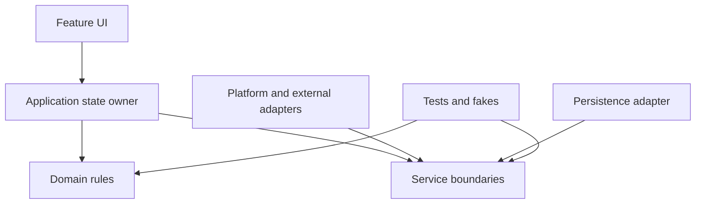

# {{APP_NAME}} architecture

- Status: **{{STATUS}}**
- Platform: **{{PLATFORM}}**
- Updated: **{{DATE}}**

## Context and constraints

Summarize the product boundary, runtime environment, offline/account assumptions, sensitive data, and the constraints that shape the design.

## System shape

State the dependency direction and the invariant the diagram is meant to show.

## Source boundaries

| Boundary | Responsibility | May depend on | Must not own |
| --- | --- | --- | --- |
| App/composition | Build dependencies, own lifecycle and top-level routing | All concrete modules at composition time | Product rules hidden in view callbacks |
| Features | Render state and send user intents | App-facing interfaces, shared UI | Persistence or platform-service coordination |
| Domain models | Deterministic rules and validated value types | Standard language libraries | UI frameworks and concrete adapters |
| Services/adapters | Files, network, sensors, health, notifications, purchases, cloud | Platform SDKs and service protocols | Unrelated product presentation |

Document the intended repository tree and identify the canonical application target.

## State ownership and data flow

Describe the single source of truth, observation model, navigation ownership, background refresh, and how a user intent reaches domain logic and persistence.

## Persistence, migration, and restore

Specify the data format, location, version, atomic transaction boundary, file/data protection, backup policy, migration behavior, restore validation, and response to load/save failure.

## Integrations and permissions

| Integration | Purpose | Data/access | Failure or denial behavior | Test substitute |
| --- | --- | --- | --- | --- |
| Add required capability | Explain why it exists | Minimize scope | Preserve a useful fallback | Name the fake, fixture, or manual check |

## Concurrency and lifecycle

Define task ownership, cancellation, duplicate refresh coalescing, stale-result rejection, observer lifetime, foreground/background behavior, and mode/profile/restore transitions.

## Privacy, security, and user control

Describe data minimization, retention, exports/deletion, secrets, transport, permissions, privacy manifests/disclosures, analytics, and account boundaries. State explicitly when data remains on device.

## Accessibility and localization

Document Dynamic Type, VoiceOver semantics/order, contrast, Reduce Motion/Transparency, touch targets, localization-safe layout, units, calendars, time zones, and right-to-left behavior that apply.

## Test architecture

| Layer | Proves | Environment |
| --- | --- | --- |
| Domain unit tests | Rules, boundaries, migrations, deterministic outcomes | Host or native unit runner |
| Coordination tests | State publication, save failures, cancellation, service substitution | Native unit runner with fakes |
| UI/device checks | Rendering, permissions, lifecycle, accessibility, platform services | Simulator and physical device as required |

## Architecture decisions

| Decision | Status | Rationale | Revisit when |
| --- | --- | --- | --- |
| Name the state ownership model | Open decision | Tie it to product complexity | Ownership or scaling assumptions change |

## Evidence and verification limits

Link claims to repository-relative files for an existing app. Record which checks were actually run and which require another host, simulator, device, account, or service. See the [app plan](APP-PLAN.md) and [technology stack](TECH-STACK.md).
