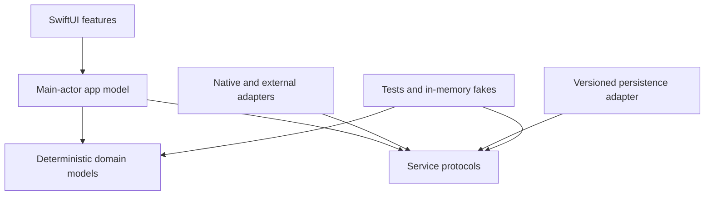

# Native iPhone reference architecture

Use this reference when the chosen product is a native iPhone app built with SwiftUI. It captures the reusable architecture shared by StepForge and StepFurr without importing either app's product mechanics.

## Recommended baseline

| Concern | Default | Reason to deviate |
| --- | --- | --- |
| UI | SwiftUI, native navigation and presentation | A required capability is unavailable or an existing app has another established UI stack |
| Deployment | iOS 17 or later, confirmed per product | The audience or required API availability supports a different target |
| Composition | `App` entry point, optional `UIApplicationDelegate`, one main-actor application model | The app is large enough to need multiple independently owned feature stores |
| State | `@MainActor` observable app model; deterministic value-type domain models | A different state system is already established and demonstrably fits the app |
| Features | Feature views grouped by user journey; shared components and design tokens separated | The repository has a consistent alternative structure |
| Services | Small protocols around HealthKit, notifications, purchases, cloud, files, sensors, and similar effects | A platform API is trivial, synchronous, and does not need substitution |
| Persistence | Versioned `Codable` state in Application Support, atomic replacement, protection and backup policy | Query-heavy, relational, shared, or cloud-synchronized data justifies SwiftData/Core Data/database storage |
| Project | Root Xcode project; XcodeGen `project.yml` when repeatable generation is useful | The existing project is maintained directly or uses another generator |
| Tests | XCTest for domain rules, persistence, service coordination, restore/migration, and layout algorithms | Add UI or integration tests where behavior cannot be proven below the UI layer |

Do not add a JavaScript runtime, WebView, Capacitor, CocoaPods, Swift package, cloud backend, or analytics SDK unless the product actually needs it. A prototype may remain in the repository without being part of the production runtime.

## Suggested source boundaries

```text
App/          composition root, app delegate, root routing, application model
Features/     screens and feature-local presentation
Models/       deterministic domain state, rules, and value types
Services/     native and external adapters
Components/   reusable UI building blocks
Design/       themes, typography, tokens, reusable styles
Resources/    assets, catalogs, fonts, privacy manifest, entitlements
Tests/        domain, persistence, coordination, and regression tests
```

Use this as a dependency direction, not merely a folder list:



Domain models must not import SwiftUI or concrete service implementations. Views request intents from the app model; they should not coordinate persistence and platform APIs themselves.

## State and transaction rules

- Build a candidate state, validate it, persist the full logical transaction, then publish it to the UI.
- A failed save must not leave visible state claiming an operation succeeded.
- A failed load must not be silently replaced by a new default save; require recovery or an explicit reset/restore path.
- Give persisted formats a version and document forward/backward compatibility.
- After backup restore or profile/mode changes, invalidate generation tokens or tasks so late asynchronous results cannot mutate the new state.
- Coalesce duplicate refreshes, cancel superseded work, and stop native queries or observers when ownership ends.
- Keep review, preview, demo, and test stores in memory or a separate container so they cannot alter production state.

## Platform integrations

For each integration, document:

- why it is required and whether it is optional;
- requested permission and the user-visible explanation;
- read/write scope and data minimization;
- behavior when denied, restricted, unavailable, empty, or partially successful;
- refresh triggers, observer ownership, background limitations, and cancellation;
- simulator/test substitutes and the real-device acceptance check.

Health values should remain unavailable when no trustworthy reading exists. Do not synthesize one metric from another unless that is an explicit product rule. Native systems control background timing, so documentation must not promise exact execution schedules.

## Delivery strategy

Start with one end-to-end vertical slice that proves navigation, state mutation, persistence, and one representative integration. Follow with migration/restore, accessibility, lifecycle, and device-only risk probes before expanding breadth. Keep platform compilation and physical-device validation separate from static source checks performed on a non-macOS host.
